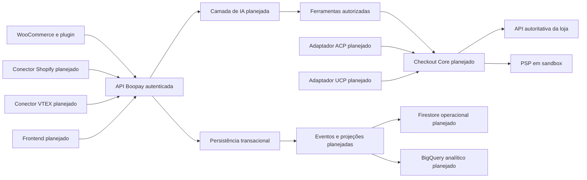

# Arquitetura do Boopay — contrato de trabalho da S1

Autor: Thiago Ventura, com apoio de Codex. Issue [#7 / RB-023](https://github.com/Pedro-Lucas001/boopay/issues/7). Checkpoint solicitado: **segunda, 19/10/2026**. Revisão independente pendente no PR.

Esta arquitetura descreve a main `6d1ede5` consultada em 16/10 e define interfaces para o desenvolvimento. O estado dos componentes futuros é explícito; o diagrama não comprova sua implementação.

## Componentes e responsabilidades

| Componente | Situação na base consultada | Responsabilidade e fronteira |
| --- | --- | --- |
| Plugin WooCommerce | Implementado em `plugin/boopay/` | Configuração administrativa, conexão, catálogo, fila e tracking consentido; não autoriza pagamento. |
| API | Implementada em `src/app.ts` e `src/http/` | Valida payload, autentica integração, limita corpo, ingere catálogo/eventos e consulta saúde. |
| Persistência atual | Prisma 5.22 com SQLite | Banco de desenvolvimento/QA atual; migrations e recibos duráveis. Não é PostgreSQL. |
| PostgreSQL | Evolução RB-024, #50 | Fonte transacional alvo; precisa migração de provider/histórico própria, ensaiada em banco descartável. |
| Camada de IA | RB-042, #10 | Interface de provedores e ferramentas com esquema, cancelamento e timeout. GPT/Gemini reais são RB-043. |
| Recuperação de catálogo | RB-044, #42 | Índice derivado por tenant/produto/versão; não decide preço final. |
| Checkout Core | RB-046, #31 | Cotação versionada, estados, confirmação, idempotência e recuperação. |
| Adaptadores ACP/UCP | RB-053/054 | Traduzem contratos externos para o mesmo core, sem duplicar regras comerciais. |
| Conectores Shopify/VTEX | RB-035–038 | APIs autorizadas por loja e versão; acesso inexistente é bloqueio, não resultado simulado. |
| Firestore | RB-025 | Projeção operacional reconstruível; não confirma pagamento nem substitui pedido transacional. |
| BigQuery | RB-026 | Histórico/agregações rastreáveis por tenant; não inicia compras. |
| Frontend | RB-029–031/049 e demais telas | Apresentação de dados autorizados, contexto de loja e revisão da compra; nunca guarda token administrativo. |

## Fontes de verdade

| Dado | Autoridade | Cópia/uso permitido |
| --- | --- | --- |
| Produto e variante | Plataforma da loja | Snapshot Boopay para busca; deve ter ID de origem e revisão. |
| Preço, estoque, frete, desconto, tributos e total de compra | Cotação autoritativa da loja | Core guarda versão/hash do resumo que o comprador revisou. |
| Confirmação | Ação explícita do comprador vinculada à versão vigente | Texto de LLM não substitui autorização. |
| Pagamento | Estado confirmado do PSP | Registro transacional por tentativa; timeout não significa recusa. |
| Pedido | Registro comercial da loja correlacionado à referência de compra | Core persiste referência antes do efeito e reconcilia respostas perdidas. |
| Consentimento/identidade | Registro verificável por finalidade e loja | CDP/projeções respeitam revogação/exclusão; identidade não é inferida por nome. |
| Métricas | Eventos/pedidos/pagamentos persistidos e regras versionadas | Agregações derivadas com janela/denominador; receita pendente não é paga. |

## Interfaces existentes

O [contrato plugin–API](contratos/plugin-v1.md) define payloads, erros, limites, assinatura e exemplos executáveis.

| Interface | Identidade e resultado |
| --- | --- |
| `POST /v1/admin/connection-codes` | Operador privilegiado emite código de cinco minutos/uso único, para tenant, merchant e URL específicos. Token administrativo permanece no servidor. |
| `POST /v1/integrations/connect` | Troca código por token e segredo; responde `no-store`. |
| `POST /v1/integrations/disconnect` | Revoga integração e impede novas operações; plugin interrompe jobs. |
| `POST /v1/admin/catalog/sync` | Bearer + HMAC; integração/merchant autorizados; recibo e lote gravados atomicamente. |
| `POST /v1/events` | Bearer + HMAC; taxonomia limitada e consentimento; deduplicação por integração/event_id. |
| `POST /v1/integrations/health` | Retorna somente saúde da integração autenticada. |
| `GET /health` | Liveness público; não revela catálogo, credenciais ou dados pessoais. |

## Interfaces a implementar sem bloquear colegas

| Fronteira | Entrada | Saída/garantia | Tarefas |
| --- | --- | --- | --- |
| Identidade de operador/contexto | Credencial do operador, loja selecionada | Associação autorizada obtida no servidor; não confiar no tenant enviado pelo cliente | #19/#51 |
| Consultas de catálogo/perfil/métricas | Contexto autorizado + filtros/paginação validados | DTO mínimo por loja, com vazio/erro definidos | #39 |
| Provedor de IA | Mensagens, configuração de modelo, ferramentas permitidas e AbortSignal | Resposta estruturada validada; erro normalizado e tempo limitado | #10/#30 |
| Execução de ferramenta | Nome permitido + argumentos validados + contexto do servidor | Resultado validado; catálogo/cotação não cobram nem criam pedidos pagos | #10/#31/#39 |
| Cotação do core | Itens/variantes/destino e contexto autorizado | Cotação da loja com versão, expiração e motivos de indisponibilidade | #31/#12/#8/#9 |
| Conclusão do core | Confirmação da cotação vigente + referência durável | Consulta recuperável de pagamento/pedido, sem duplicação | #31/#32/#33/#53 |
| Eventos de projeção | ID, versão, tenant, instante e referência de origem | Aplicação idempotente, rastreável e reconstruível | #38/#61/#40/#57/#67 |

Contratos podem avançar em paralelo. Fixtures/doubles são identificados e não constituem integração aceita. Alterações de formato exigem atualizar produtor, consumidor, contrato e testes pertinentes no PR.

## Decisões e motivos

1. **Um core comercial.** ACP, UCP, chat e interfaces próprias chamam o mesmo conjunto de regras para evitar formas diferentes de confirmar/cobrar a mesma compra.
2. **Dados transacionais separados de projeções.** Firestore e BigQuery podem atrasar sem provocar novo pagamento ou alterar a autoridade da loja.
3. **Isolamento em cada fronteira.** Chaves, consultas, filas, cache, eventos e logs carregam contexto validado; ID de produto/SKU sozinho não identifica a loja.
4. **Versões fixadas.** SDK mais recente e `/latest/` não definem o contrato aceito pela superfície. UCP/ACP têm mapeamento explícito, schemas por operação e evidência do alvo.
5. **Confirmação explícita.** Mudança comercial relevante invalida confirmação anterior; credenciais de pagamento não são enviadas ao LLM.
6. **Referências antes dos efeitos.** Unicidade/transação e consulta ao provedor protegem repetição, concorrência e reinício; memória do processo não basta.
7. **Migração planejada.** SQLite continua identificável até a entrega PostgreSQL. Não reaplicar SQL SQLite em PostgreSQL ou resetar banco compartilhado.
8. **Evidência por ambiente.** Fixture, teste local, sandbox de provedor e superfície oficial são estados diferentes. Homologação #21 continua futura.

## Erros, recuperação e observabilidade

| Falha | Conduta |
| --- | --- |
| Payload inválido | Rejeitar antes do efeito; retornar código estável, sem stack/payload sensível. |
| Credencial expirada/revogada ou loja não autorizada | Negar; não tentar resolver autorização pelo LLM. |
| Replay de transporte | Rejeitar nonce; retry legítimo usa nonce novo e conserva ID/corpo do evento. |
| Evento duplicado | Retornar resultado idempotente; mesmo ID/corpo diferente é conflito. |
| Evento antigo após exclusão | Não restaurar tombstone; comparar revisão do produto. |
| Timeout de IA | Cancelar espera e retornar indisponibilidade; não fabricar resposta. |
| Timeout após efeito de pagamento/pedido | Estado incerto e reconciliação; consultar referência original antes de nova tentativa. |
| Projeção indisponível | Reprocessar evento durável com limite; compra não é repetida. |
| Webhook atrasado/repetido | Recibo por evento e transições consistentes; atualizar projeções sem regredir estado confirmado. |

Correlacionar request, integração, tenant, evento, sessão, tentativa e pedido conforme disponíveis. Registrar código/latência/resultado sem token, segredo, cartão ou dados pessoais desnecessários. Outbox e reconciliação são entregas planejadas, não recursos já validados nesta base.

## Fluxo comercial alvo

1. Agente consulta catálogo autorizado e recebe produtos reais.
2. Core solicita cotação à loja e apresenta resumo versionado ao comprador.
3. Comprador confirma a versão vigente; core grava referência idempotente.
4. Provedor processa pagamento sandbox e loja cria/consulta pedido pelo vínculo durável.
5. Resposta perdida é recuperada por consulta/reconciliação.
6. Eventos persistidos alimentam perfil e métricas da loja correta; contexto incompleto é visível.

## Validação e limites desta entrega

Conferida a correspondência com `src/app.ts`, `src/http/`, `src/security/`, `prisma/schema.prisma`, contrato v1 e planejamento. `npm run check:docs` e `git diff --check` são a validação desta mudança documental. Este documento não executa a jornada futura ou confirma decisões aceitas pelo time; isso depende dos PRs das respectivas tarefas.
