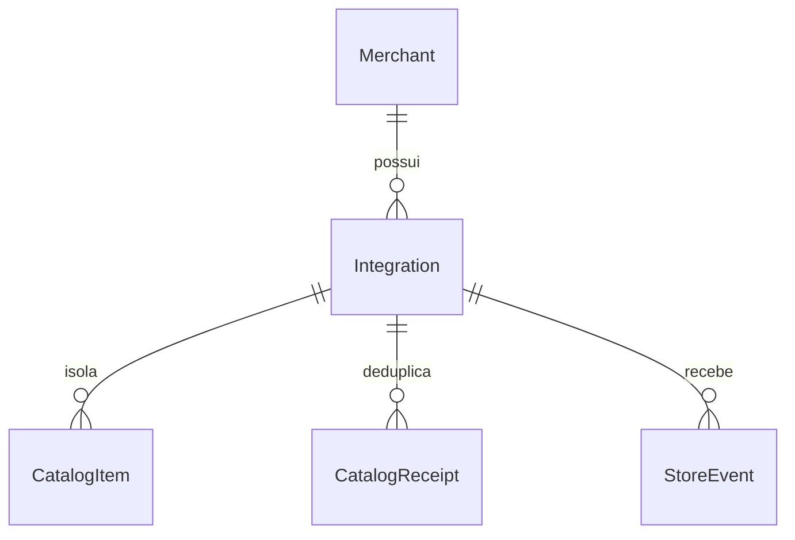

# API do plugin — RB-005, RB-006, RB-007, RB-016 e RB-019

Implementação e validação: Thiago Ventura, preservando autoria inicial de Pedro nas rotas. Revisão humana pendente; nenhum card concluído por este documento.

## Decisão e estrutura

Merchant: cadastro mínimo do lojista; Integration: credencial/tenant/loja/revogação; CatalogItem: integração+sourceId, revisão BigInt, tombstone e snapshot completo; CatalogReceipt: integração+eventId e hash do corpo; StoreEvent: integração+eventId, tipo, pseudônimo e instantes. ReplayNonce protege transporte separadamente da deduplicação de negócio. Fonte de verdade comercial: WooCommerce; API mantém a projeção. Product é legado preservado, não é identidade dos novos envios.

## Ambiente e migração

Node 22 (CI), PHP 8.3 (cliente), Prisma 5.22, SQLite sintético. `npm ci --ignore-scripts`, `npm run db:generate`, definir DATABASE_URL para **novo** arquivo de desenvolvimento, `npm run db:migrate`, `npx tsx scripts/seed-demo.ts`. O seed é sintético e idempotente. Para reset, escolher outro arquivo de banco; não apagar banco compartilhado. Fixtures: [catalog-v1.json](../../tests/fixtures/catalog-v1.json).

Migração 20261012120000 é aditiva; não converte SKU legado sem identidade de origem confiável. Backup do banco antes de deploy. Para retornar, parar os envios e reverter aplicação mantendo tabelas; não apagar tombstones/recibos. Fazer nova sincronização só após restabelecer backend compatível.

## Validação e revisão

`npm run check` executa contrato, segurança e ingestão em bancos temporários. Cenários incluem lote inválido sem escrita, delete antes de upsert antigo, variações vazias, SKU vazio em duas integrações, recibo repetido/conflitante, concorrência, evento sem consentimento/PII rejeitado e saúde isolada. A integração real WordPress passou em 42 verificações no PR #94, com [resultado](../evidencias/WORDPRESS/results.json) e [matriz/limites](./RB-020.md).

Revisão da main 3f22847: RB-005 tinha apenas contrato parcial de catálogo; RB-015 tinha rota receptora, sem hooks, ordenação ou reconciliação de variações. **Não aprovados para Feito nessa revisão.** A complementação segue em PRs; Pedro deve revisar a mudança de contrato e o mapa de hooks.

Riscos: retenção de recibos/eventos ainda exige política operacional; snapshot limitado a 100 variações/20 imagens; não cobre pagamentos, pedidos ou checkout. A revisão humana e o ensaio da equipe continuam pendentes.
